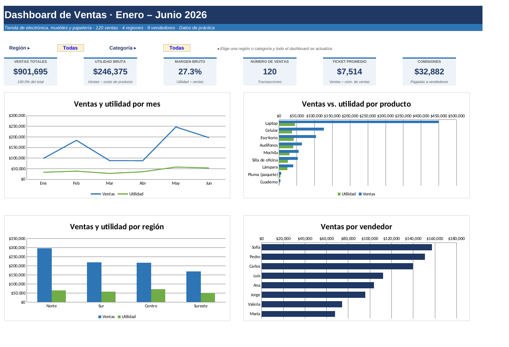

# Análisis de Ventas y Dashboard en Excel · Enero – Junio 2026

## Objetivo
Entender qué productos, regiones y vendedores generan las ventas **y la utilidad** de una tienda de electrónica, muebles y papelería, para decidir dónde enfocar el negocio.

## Datos
- 120 ventas de enero a junio de 2026 (datos de práctica creados para el proyecto)
- 9 productos · 3 categorías · 4 regiones · 8 vendedores
- Catálogos de costos por producto y comisiones por vendedor

## Qué hice
1. **Organicé el archivo** en hojas separadas: Inicio, Dashboard, Ventas, Análisis, Cálculos, Catálogos y Documentación.
2. **Preparé los datos** como tabla de Excel, con formatos de fecha, moneda y porcentaje.
3. **Crucé tablas con BUSCARX** para traer el costo de cada producto y la comisión de cada vendedor.
4. **Calculé nuevas métricas:** costo, utilidad bruta, margen, comisión y venta en dólares.
5. **Respondí preguntas de negocio** con CONTAR.SI, SUMAR.SI y sus versiones .CONJUNTO.
6. **Revisé la calidad de los datos:** duplicados, celdas vacías, productos sin costo y vendedores fuera del catálogo.
7. **Construí un dashboard interactivo** con filtros de región y categoría, 6 KPIs y 4 gráficos.

## Hallazgos principales
| # | Hallazgo |
|---|---|
| 1 | La **Laptop** genera el **50% de las ventas**, pero solo el **18% de la utilidad** (margen de 10%). |
| 2 | **Muebles** es el 22% de las ventas y el **37% de la utilidad** (margen de 46%). |
| 3 | Las ventas son inestables: **mayo casi triplica a abril**, impulsado por Electrónica. |
| 4 | **Norte** es la región que más vende, pero **Centro** es la que más utilidad deja. |
| 5 | **Calidad de datos:** Valeria tiene 11 ventas ($74,220) y no está en el catálogo de vendedores, así que su comisión no se puede calcular. |

## Recomendación
Mantener la Laptop como producto de entrada, pero ofrecer accesorios y muebles en cada venta para subir el margen. Dar de alta a Valeria en el catálogo para pagar sus comisiones correctamente.

## Herramientas
Microsoft Excel: tablas, BUSCARX, SUMAR.SI.CONJUNTO, CONTAR.SI.CONJUNTO, validación de datos (filtros), formato condicional y gráficos.

## Archivos
- `Analisis_Ventas_2026.xlsx`: archivo completo (abre la hoja **Inicio**)
- `dashboard.png`: vista del dashboard

---
**Autor:** Angel Regino Cabrera · [github.com/angel-regino](https://github.com/angel-regino)
